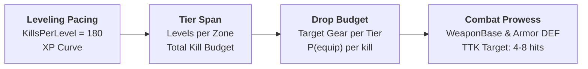

# 📘 **EQUIPMENT PROGRESSION & DROP RATE PACING GUIDE**

**File:** `Docs/Inventory/Equipment_Drop_Pacing.md`  
**Category:** Itemization · Progression Pacing · Combat Power Growth  
**Companion Documents:** [`Docs/combat-formulas.md`](../combat-formulas.md) · [`Docs/Inventory/Inventory_System.md`](Inventory_System.md) · [`Docs/Player/Leveling_System.md`](../Player/Leveling_System.md)  
**Companion Spreadsheet:** [`Docs/combat-tuning-calculator.xlsx`](../combat-tuning-calculator.xlsx) (`GearTiers` & `ProgressionCurve` sheets)

---

## 1. Overview & Executive Summary

In Onset’s combat formulas, **equipment drives 80% to 90% of a character's absolute combat power**, while leveling provides the stat multiplier layer. Because gear base values ($\text{WeaponBase}$ and armor $\text{DEF}$) dominate over flat level-up stat points:
* **If drop rates are too low:** A player levels up faster than their gear improves. Against zone-scaled enemies, their damage falls behind, Time-to-Kill (TTK) balloons, and combat feels like a grind.
* **If drop rates are too high:** Bags overflow with inventory clutter, gear upgrades lose their dopamine hit, and content difficulty is trivialized.

This document establishes the **mathematical framework, probability models, enemy drop hierarchies, and bad-luck safety nets** required to tune `DT_Loot` so that equipment drops keep natural pace with character leveling.

---

## 2. The Core Mathematical Relationship

Drop rate tuning connects three interdependent systems:



### The Drop Rate Formula
For any progression tier spanning $\Delta L$ levels:

$$\text{Total Kill Budget} = \Delta L \times \text{KillsPerLevel}$$

$$\text{Equipment Drop Rate } (P_{\text{equip}}) = \frac{\text{Target Total Equipment Drops in Tier}}{\text{Total Kill Budget}}$$

### Target Slot Coverage
A character has **11 equipment slots**:
* $1\times$ Main-Hand Weapon
* $1\times$ Shield / Off-Hand
* $5\times$ Armor (Head, Chest, Hands, Legs, Feet)
* $4\times$ Accessories (Amulet, Ring 1, Ring 2, Trinket)

To ensure a player comfortably equips all 11 slots (accounting for duplicate slot drops and rolling off-archetype items), a player should acquire **$40 \text{ to } 60$ total equipment drops** across a 15-to-25 level tier span.

---

## 3. Tier Progression & Kill Budget Breakdown

Onset is structured around **6 progression tiers** (from Level 1 Starter to Level 200 Rebirth Cap), calibrated against `KillsPerLevel = 180`:

| Tier | Level Band | Level Span ($\Delta L$) | Kill Budget ($180 \times \Delta L$) | Active Playtime (@200 k/hr) | Target Drops in Tier | Required Base Drop Rate ($P_{\text{equip}}$) |
|:---:|:---:|:---:|:---:|:---:|:---:|:---:|
| **Tier 0** | 1 – 4 | 4 levels | $720\text{ kills}$ | $3.6\text{ hrs}$ | $15\text{ items}$ | **$2.08\%$** |
| **Tier 1** | 5 – 19 | 15 levels | $2,700\text{ kills}$ | $13.5\text{ hrs}$ | $55\text{ items}$ | **$2.04\%$** |
| **Tier 2** | 20 – 49 | 30 levels | $5,400\text{ kills}$ | $27.0\text{ hrs}$ | $90\text{ items}$ | **$1.67\%$** |
| **Tier 3** | 50 – 99 | 50 levels | $9,000\text{ kills}$ | $45.0\text{ hrs}$ | $130\text{ items}$ | **$1.44\%$** |
| **Tier 4** | 100 – 199 | 100 levels | $18,000\text{ kills}$ | $90.0\text{ hrs}$ | $220\text{ items}$ | **$1.22\%$** |
| **Tier 5** | 200 (Cap) | Loop Rebirth | Continuous | — | Prestige BiS | High End / Boss Gated |

> [!NOTE]
> Drop rates gently taper from **$\sim 3.0\%$ early game** to **$\sim 1.2\%$ late game**. In early levels, rapid item turnover keeps new players engaged and replaces starter gear quickly; late game shifts toward optimizing substats and item affixes.

---

## 4. Enemy Hierarchy & Drop Rate Architecture

Do not apply a flat drop chance across all mobs. Instead, distribute the equipment budget across enemy classifications to reward encounter difficulty:

| Enemy Classification | Typical Share of Mobs | Equipment Drop Rate ($P$) | Role in Loot Economy |
|---|:---:|:---:|---|
| **Common Grunt (Trash)** | $88\% - 90\%$ | **$2.5\% \text{ to } 3.5\%$** | Steady trickle; primarily drops Gold, Consumables, and Junk |
| **Elite / Champion** | $8\% - 10\%$ | **$25.0\% \text{ to } 40.0\%$** | Primary target for active farming; $\sim 1$ drop every 3 elites |
| **Zone Boss / Dungeon End** | $\sim 1\%$ | **$100\%$ (Guaranteed 1–3)** | Milestone payout; guaranteed high-tier / rare item |

### Pacing Simulation (Per Level = 180 Kills)
In an average level of 180 kills, a typical encounter mix yields:
* **160 Grunts** $\times 3\% = \mathbf{4.8\text{ equipment items}}$
* **18 Elites** $\times 30\% = \mathbf{5.4\text{ equipment items}}$
* **2 Bosses / Minibosses** $\times 100\% = \mathbf{2.0\text{ equipment items}}$
* **Total per level:** $\mathbf{\sim 12\text{ equipment drops per level}}$.

At an active kill rate of 200 kills/hour, this averages **one equipment drop every 4 to 5 minutes**, providing steady excitement without burying the player in inventory management.

---

## 5. Probability Analysis & The Weapon Starvation Dilemma

Weapon Base Damage accounts for more than half of the player's damage equation. If pure RNG fails to drop a weapon for several levels, the player's combat effectiveness collapses.

The cumulative probability of finding **at least one** item of a specific slot across $K$ kills is:

$$P(\ge 1\text{ drop}) = 1 - (1 - p)^K$$

Where $p = P_{\text{equip}} \times P_{\text{slot}} \times P_{\text{usable}}$.

Assuming:
* $P_{\text{equip}} = 3.5\%$
* Weapon share of equipment table $P_{\text{slot}} = 18\%$ (weapons weighted slightly higher than individual armor slots)
* Effective per-kill weapon chance: $p = 0.035 \times 0.18 = \mathbf{0.0063\text{ (0.63\% per kill)}}$.

| Kills Completed | Equivalent Levels | Probability of $\ge 1$ Weapon Drop | Status |
|:---:|:---:|:---:|---|
| **50 kills** | 0.28 levels ($\sim 15\text{ mins}$) | $27.1\%$ | Early trial |
| **100 kills** | 0.55 levels ($\sim 30\text{ mins}$) | $46.9\%$ | Half level |
| **200 kills** | 1.11 levels ($\sim 1\text{ hr}$) | **$71.8\%$** | Most players upgraded |
| **350 kills** | 1.94 levels ($\sim 1.7\text{ hrs}$) | **$89.1\%$** | High confidence |
| **500 kills** | 2.77 levels ($\sim 2.5\text{ hrs}$) | **$95.8\%$** | Bad luck threshold |

> [!WARNING]
> **The 5% Unlucky Tail:** Under pure RNG, approximately **$4.2\%$ of players will kill 500 mobs ($\sim 2.8$ levels) without ever seeing a weapon drop**. In an ARPG, this causes player churn. Pure RNG must always be paired with deterministic safety nets.

---

## 6. The Three Essential Safety Nets (Bad-Luck Protection)

To prevent players from falling behind the level curve due to bad RNG, implement these three standard ARPG mechanics:

```
┌─────────────────────────────────────────────────────────────┐
│                 LOOT PROGRESSION SAFETY NETS                │
├─────────────────────────────────────────────────────────────┤
│ 1. QUEST MILESTONES (Guaranteed baseline weapon at Lv 5,20) │
│ 2. TOWN VENDORS / SCRAP (Buy baseline on-tier gear with junk)│
│ 3. SMART LOOT WEIGHTING (Bias drops toward player class)    │
└─────────────────────────────────────────────────────────────┘
```

### Safety Net 1: Milestone Quest Rewards
* In [`DT_QuestDefinition`](file:///e:/Unreal%20Projects/PortfolioTutorial/Project/Content/Data/DT_QuestDefinition.uasset), author guaranteed baseline on-tier weapon rewards upon reaching tier thresholds (e.g., Level 5, Level 20, Level 50).
* **Rule:** A player should *never* enter a new zone tier with a weapon two tiers out of date.

### Safety Net 2: Town Vendors / Salvage Economy
* Enemies drop vendor junk (`DT_Junk`) and currency.
* Town vendors stock generic "Common" weapons and armor matching the zone's tier at flat gold prices.
* **Tuning Rule:** 1 level worth of junk/gold ($180$ kills) should provide enough currency to purchase a baseline on-tier weapon from a shop.

### Safety Net 3: Smart Loot / Class Weighting
* When rolling `DT_Equipment` rows, weight items matching the active character's class:
  * Melee DPS: $60\%$ Swords/Axes/Daggers, $40\%$ other.
  * Caster DPS: $60\%$ Staves/Wands, $40\%$ other.
  * Tank: $50\%$ Shields/Maces, $50\%$ other.
* Prevents a Caster from finding 10 consecutive two-handed broadswords.

---

## 7. Concrete Configuration in Onset's DataTables

Onset's existing loot architecture in [`OnsetLootTypes.h`](file:///e:/Unreal%20Projects/PortfolioTutorial/Project/Source/Onset/Public/Data/OnsetLootTypes.h) and [`OnsetLootLibrary.cpp`](file:///e:/Unreal%20Projects/PortfolioTutorial/Project/Source/Onset/Private/Combat/OnsetLootLibrary.cpp) supports hierarchical sub-tables and level bounds out of the box.

### Recommended `DT_Loot` Table Hierarchy

```
DT_Loot
 ├── LT_Zone1_Grunt (Assigned to Grunt DT_EnemyStats)
 │    ├── Entry: Gold / Junk (DropChance = 0.50, MinQty = 1, MaxQty = 3)
 │    ├── Entry: Minor Health Potion (DropChance = 0.08)
 │    └── SubTable: ST_Tier1_Equipment (InclusionChance = 0.035)
 │
 ├── LT_Zone1_Elite (Assigned to Elite DT_EnemyStats)
 │    ├── Entry: Gold / Junk (DropChance = 1.00, MinQty = 5, MaxQty = 10)
 │    ├── Entry: Minor Health Potion (DropChance = 0.50)
 │    └── SubTable: ST_Tier1_Equipment (InclusionChance = 0.350)
 │
 └── ST_Tier1_Equipment (Reusable Sub-Table)
      ├── Entry: IronSword     (Item=IronSword,     DropChance=0.18, MinLevel=1, MaxLevel=15)
      ├── Entry: IronDagger    (Item=IronDagger,    DropChance=0.18, MinLevel=1, MaxLevel=15)
      ├── Entry: WoodenStaff   (Item=WoodenStaff,   DropChance=0.18, MinLevel=1, MaxLevel=15)
      ├── Entry: LeatherChest  (Item=LeatherChest,  DropChance=0.15, MinLevel=1, MaxLevel=15)
      ├── Entry: LeatherBoots  (Item=LeatherBoots,  DropChance=0.15, MinLevel=1, MaxLevel=15)
      └── Entry: IronShield    (Item=IronShield,    DropChance=0.16, MinLevel=1, MaxLevel=15)
```

### Key Field Settings in `FOnsetLootEntry`:
1. **`MinLevel` and `MaxLevel`:** Set these to the tier's level band (e.g. `MinLevel = 5, MaxLevel = 20`). This prevents low-level characters from receiving endgame gear and stops high-level characters from farming starter gear.
2. **`InclusionChance` on `FOnsetLootSubTableRef`:** Use this as the master dial for enemy rank:
   * Grunts: `InclusionChance = 0.03`
   * Elites: `InclusionChance = 0.35`
   * Bosses: `InclusionChance = 1.00` (often rolling the sub-table 2 or 3 times).

---

## 8. Summary Checklist for Tuning Loot & Progression

- [ ] **Verify Level Pacing:** Ensure `KillsPerLevel` in `DefaultEngine.ini` matches the design goal (default: `180`).
- [ ] **Set Grunt Equipment Chance:** Configure grunt loot tables with $\sim 2.5\% \text{ to } 3.5\%$ equipment sub-table inclusion.
- [ ] **Set Elite Equipment Chance:** Configure elite loot tables with $\sim 30\% \text{ to } 40\%$ equipment sub-table inclusion.
- [ ] **Author Guaranteed Boss Drops:** Ensure bosses carry $100\%$ drop chances for at least 1 weapon and 1 armor piece.
- [ ] **Gate Items by Level:** Populate `MinLevel` and `MaxLevel` on all `DT_Equipment` and `DT_Loot` rows to match the tier bands in `combat-tuning-calculator.xlsx`.
- [ ] **Add Quest Fallbacks:** Add guaranteed on-tier weapons to milestone quest rewards in `DT_QuestDefinition` for Levels 5, 20, and 50.
- [ ] **Validate TTK in Spreadsheet:** Check the `ProgressionCurve` tab in [`combat-tuning-calculator.xlsx`](../combat-tuning-calculator.xlsx) to confirm that player TTK stays within the healthy **4 to 8 hit window** across all tiers.
