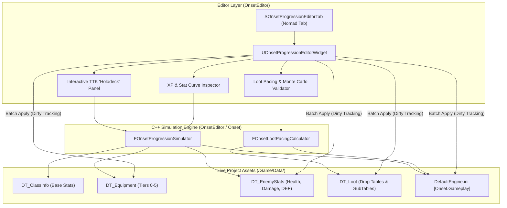

# ⚖️ **PROGRESSION & BALANCE WORKBENCH — IMPLEMENTATION HANDOFF**

**File:** `Docs/Tools/Progression_Balance_Tool_Handoff.md`  
**Target Module:** `Project/Source/OnsetEditor`  
**Status:** Architecture Complete · Ready for Implementation  
**Companion Documents:**
* [`Docs/combat-formulas.md`](../combat-formulas.md)
* [`Docs/Inventory/Equipment_Drop_Pacing.md`](../Inventory/Equipment_Drop_Pacing.md)
* [`Docs/Inventory/Inventory_System.md`](../Inventory/Inventory_System.md)
* [`Docs/Player/Leveling_System.md`](../Player/Leveling_System.md)
* [`Docs/Tools/Enemy_Editor.md`](Enemy_Editor.md)
* [`Docs/Tools/Item_Loot_Editor.md`](Item_Loot_Editor.md)
* [`Docs/combat-tuning-calculator.xlsx`](../combat-tuning-calculator.xlsx)

---

## 1. Executive Summary & Feasibility

### 1.1 Is this doable?
**Yes, 100%.** The project's existing architecture is uniquely well-suited for this tooling:
1. **Editor Infrastructure:** `OnsetEditor` already features three production Nomad tab tools (`OnsetAbilityEditorWidget`, `OnsetEnemyEditorWidget`, `OnsetItemEditorWidget`) using Unreal's `SDockTab`, `UEditorUtilityWidget`, and custom `UOnsetNotifyDetailsView` with automatic persistence on tab close.
2. **Decoupled Data Architecture:** All balance variables reside in centralized DataTables (`DT_ClassInfo`, `DT_Equipment`, `DT_EnemyStats`, `DT_Loot`) and clean ini seams under `[Onset.Gameplay]` in `DefaultEngine.ini`.
3. **Rigorous Mathematical Foundation:** The combat, leveling, mitigation, and loot formulas are fully codified in `Docs/combat-formulas.md`, validated in `Docs/combat-tuning-calculator.xlsx`, and budgeted in `Docs/Inventory/Equipment_Drop_Pacing.md`.

### 1.2 Purpose of the Tool
The **Progression & Balance Workbench** (`UOnsetProgressionEditorWidget`) will be a unified editor tab that brings Leveling, Equipment Tiers, Enemy Scaling, and Loot Drop Rates into an **interlinked live simulation environment**. A designer can adjust an XP curve or equipment drop rate and immediately observe the downstream impact on Time-to-Kill (TTK), player survival, and drop pacing across all 6 tiers of the game.

---

## 2. System Architecture & Data Flow



### 2.1 Configuration Seams & DataTable Paths
All data paths are defined in `Project/Config/DefaultEngine.ini` under `[Onset.Gameplay]`:
* `ClassDataTable`: `/Game/Data/ClassInfo.ClassInfo` (`FOnsetCharacterClassInfo`)
* `EquipmentDataTable`: `/Game/Data/DT_Equipment.DT_Equipment` (`FOnsetEquipmentDefinition`)
* `EnemyStatsDataTable`: `/Game/Data/DT_EnemyStats.DT_EnemyStats` (`FOnsetEnemyStats`)
* `LootDataTable`: `/Game/Data/DT_Loot.DT_Loot` (`FOnsetLootTableRow`)
* `KZoneTierScale`: Global mitigation tuning scale ($1.0$).
* `KDefense`: $100.0$ (Physical mitigation soft-cap).
* `KElemental`: $80.0$ (Elemental mitigation soft-cap).
* `XpBase`: $50$, `XpGrowth`: $0.06$, `KillsPerLevel`: $180$, `LevelCap`: $200$, `StatPointsPerLevel`: $3$.

---

## 3. UI/UX Design & Layout

The tool is accessible via: **Menu Bar → Onset Tools → Progression & Balance Workbench**.

```
┌────────────────────────────────────────────────────────────────────────────────────────┐
│  ⚖️ ONSET PROGRESSION & BALANCE WORKBENCH                                              │
├──────────────────────────┬─────────────────────────────┬───────────────────────────────┤
│ 1. CURVE & STATS         │ 2. COMBAT SIMULATOR (HOLODECK)│ 3. LOOT & DROP PACING         │
│                          │                             │                               │
│ [Preset: Standard ARPG ▼]│ [Player Setup]              │ [Tier Kill Budget]            │
│ XP Base:           [50 ] │ Class:  [Melee DPS (Warrior)▼] Tier: [Tier 1 (Lvl 5-19)   ▼]│
│ XP Growth:       [0.06 ] │ Level:  [ 15 ] (Slider 1-200)│ Levels (ΔL):      [ 15      ]│
│ Kills / Level:    [180 ] │ Gear:   [Tier 1: Iron Set  ▼]│ Kill Budget:      2,700 kills │
│ Stat Pts / Lvl:    [ 3 ] │ Weapon: [Sword & Shield    ▼]│ Playtime (@200k/h): 13.5 hrs  │
│                          │ Allocated Stats:            │ Target Drops:     [ 55      ]│
│ Total XP (Lvl 15): 1,132 │ STR: 25 | VIT: 15 | DEF: 20 │ Required P(drop):  2.04%     │
│ Cumulative Kills:  2,700 │                             ├───────────────────────────────┤
│                          │ [Enemy Target]              │ [Loot Table Tuning]           │
│ [Tier Brackets]          │ Enemy:  [OrcBrute (Lvl 15) ▼] Loot Table: [ST_Tier1_Equip ▼]│
│ T0: 1-4   | T1: 5-19     │ Rank:   [Elite (1.5x HP)   ▼] Base Drop Rate:     [ 2.50% ]  │
│ T2: 20-49 | T3: 50-99    │ HP: 650 | DEF: 45 | DMG: 38 │ Inclusion Chance:   [ 85.0% ] │
│ T4: 100-199 | T5: 200    ├─────────────────────────────┼───────────────────────────────┤
│                          │ [Combat Simulation Results] │ [Monte Carlo Roll Validator]  │
│ [Gear Budget Table]      │ Player Damage / Hit:  82.4  │ Iterations:        [ 10,000 ] │
│ Slot       Base   DEF    │ Enemy Physical Mit:   31.0% │ Simulated Drops:   206 items  │
│ Weapon      42     0     │ Net Hit Damage:       56.9  │ Drop Frequency:    1 in 48.5  │
│ Chest        0    18     │ Attacks / Sec:        1.25  │ Max Drought Streak: 184 kills │
│ Shield       0    12     │ Player DPS:           71.1  │ Usable Upgrades:   62 items   │
│ Total DEF:        30     │ Time-To-Kill (TTK):   9.1s  │ [ Run Monte Carlo Test ]      │
│                          │ Hits-To-Kill (HTK):   12    │ Status: ✅ Balanced Pacing    │
│                          │ Enemy DPS to Player:  24.2  │                               │
│                          │ Player Survival Time: 28.5s │                               │
│                          │ Pacing Rating: 🟢 OPTIMAL   │                               │
├──────────────────────────┴─────────────────────────────┴───────────────────────────────┤
│ Status: Ready. All DataTables validated.                                               │
│ [Preview Table Diffs]   [Revert Changes]   [Commit Changes to DataTables & Engine.ini] │
└────────────────────────────────────────────────────────────────────────────────────────┘
```

### 3.1 Panel Functions
1. **Pane 1: Curve & Stats:**
   - Visualizes leveling progression, XP requirements, and stat budgets.
   - Allows live editing of `XPBase`, `XPGrowth`, and `KillsPerLevel`.
   - Inspects the stat-budget allocations across all 11 equipment slots for any tier.
2. **Pane 2: Combat Simulator ("The Holodeck"):**
   - Live two-way combat evaluator.
   - Choose any Player Class, Level, and Gear Tier; pit them against any Enemy row in `DT_EnemyStats`.
   - Calculates real-time Damage, Defense Mitigation, Attacks per Second, DPS, TTK, and Player Survival Time.
   - Color-coded pacing alerts:
     - 🟢 **Optimal:** TTK $4.0\text{s} - 10.0\text{s}$ (Player survival $> 20\text{s}$)
     - 🟡 **Warning:** TTK $10.1\text{s} - 18.0\text{s}$ or $< 3.0\text{s}$
     - 🔴 **Critical:** TTK $> 18.0\text{s}$ (damage sponge grind) or $< 1.5\text{s}$ (trivialized boss)
3. **Pane 3: Loot Pacing & Monte Carlo Validator:**
   - Computes expected kill budgets per tier ($\Delta L \times \text{KillsPerLevel}$).
   - Derives recommended base drop rates ($P_{\text{equip}}$) and subtable `InclusionChance`.
   - Built-in 10,000-kill Monte Carlo simulator evaluates RNG variance, drop droughts, and validates bad-luck protection safety nets.
4. **Bottom Action Bar:**
   - **Preview Table Diffs:** Shows exactly which rows in `DT_EnemyStats`, `DT_Equipment`, and `DT_Loot` will change.
   - **Commit Changes:** Atomically writes modified rows back to DataTables and updates `DefaultEngine.ini` with dirty tracking.

---

## 4. Mathematical Specifications

The implementing agent must implement the exact mathematical models from `combat-formulas.md` and `Equipment_Drop_Pacing.md`.

### 4.1 Leveling & Experience
$$\text{XPRequired}(L) = \text{XPBase} \times (1 + \text{XPGrowth})^{L-1}$$
$$\text{EnemyBaseXP}(L) = \frac{\text{XPRequired}(L)}{\text{KillsPerLevel}}$$
$$\text{LevelDiff} = L_{\text{Enemy}} - L_{\text{Player}}$$
$$\text{XPMultiplier} = \begin{cases} 
0.0 & \text{if } \text{LevelDiff} \le -10 \\
\frac{\text{LevelDiff} + 10}{5} & \text{if } -10 < \text{LevelDiff} \le -5 \\
1.0 & \text{if } -5 < \text{LevelDiff} \le 0 \\
1.0 + \min(0.05 \times \text{LevelDiff}, 0.50) & \text{if } \text{LevelDiff} > 0
\end{cases}$$

### 4.2 Stat Growth & Scaling
$$\text{TotalStatPoints}(L) = (L - 1) \times \text{StatPointsPerLevel}$$
$$\text{AllocatedStat} = \text{TotalStatPoints}(L) \times \text{ClassStatWeight}$$
$$\text{TotalStat} = \text{BaseStat}_{\text{Class}} + \text{AllocatedStat} + \text{GearStat}_{\text{Tier}}$$
$$\text{MaxHealth} = \text{BaseHealth} + (\text{TotalVIT} \times \text{HealthPerVitality})$$

### 4.3 Damage & Mitigation Pipeline
$$\text{RawWeaponDamage} = \text{WeaponBase} \times \left(1 + \frac{\text{TotalSTR}}{100}\right)$$
$$\text{PhysicalMitigation\%} = \frac{\text{DEF}}{\text{DEF} + (K_{\text{DEF}} \times K_{\text{ZoneTierScale}})} \quad \text{where } K_{\text{DEF}} = 100.0$$
$$\text{NetDamagePerHit} = \text{RawWeaponDamage} \times (1 - \text{PhysicalMitigation\%})$$
$$\text{EffectiveCooldown} = \text{BaseCooldown}_{\text{Archetype}} \times \left(1 - \frac{\text{TotalAGI}}{\text{TotalAGI} + 200}\right) \times (1 - \text{CDR}_{\text{Mastery}})$$
$$\text{AttacksPerSecond} = \frac{1}{\max(\text{EffectiveCooldown}, 0.20)}$$
$$\text{DPS} = \text{NetDamagePerHit} \times \text{AttacksPerSecond} \times (1 + \text{CritChance\%} \times (\text{CritMult} - 1))$$
$$\text{Time-To-Kill (TTK)} = \frac{\text{EnemyMaxHealth}}{\text{PlayerDPS}}$$

### 4.4 Loot Pacing & Probabilities
$$\text{KillBudget}(\text{Tier}) = (L_{\text{Max}} - L_{\text{Min}} + 1) \times \text{KillsPerLevel}$$
$$P_{\text{equip}} = \frac{\text{TargetDropsInTier}}{\text{KillBudget}(\text{Tier})}$$
$$\text{InclusionChance}(\text{SubTable}) = \min\left(1.0, \frac{P_{\text{equip}}}{P_{\text{ParentTableEntry}}}\right)$$

---

## 5. C++ Class Architecture

All new classes must be created within `Project/Source/OnsetEditor/`:

### 5.1 Math Engine: `FOnsetProgressionSimulator`
Located in `Public/Progression/OnsetProgressionSimulator.h` and `Private/Progression/OnsetProgressionSimulator.cpp`.

```cpp
#pragma once

#include "CoreMinimal.h"
#include "Data/OnsetCharacterClassInfo.h"
#include "Data/OnsetEquipmentTypes.h"

struct FPlayerCombatSnapshot
{
    float MaxHealth = 100.0f;
    float EffectiveHP = 100.0f;
    float RawDamagePerHit = 10.0f;
    float NetDamagePerHit = 10.0f;
    float AttacksPerSecond = 1.0f;
    float DPS = 10.0f;
    float DefenseMitigationPct = 0.0f;
    float CritChance = 0.05f;
    float CritMultiplier = 1.50f;
};

struct FSimulationResult
{
    float PlayerDPS = 0.0f;
    float EnemyDPS = 0.0f;
    float TimeToKillSeconds = 0.0f;
    int32 HitsToKill = 0;
    float PlayerSurvivalSeconds = 0.0f;
    int32 HitsToKillPlayer = 0;
    FString PacingStatus; // "Optimal", "Slow", "Fast", "Deadly"
    FLinearColor PacingColor;
};

class FOnsetProgressionSimulator
{
public:
    static float CalculateXPRequired(int32 Level, float XPBase, float XPGrowth);
    static float CalculateEnemyBaseXP(int32 Level, float XPBase, float XPGrowth, int32 KillsPerLevel);
    
    static FPlayerCombatSnapshot EvaluatePlayer(
        const FOnsetCharacterClassInfo& ClassInfo,
        int32 Level,
        const TArray<FOnsetEquipmentDefinition>& EquippedGear,
        const TMap<FName, float>& AllocatedStatPoints,
        float KDefense,
        float KZoneTierScale
    );

    static FSimulationResult SimulateCombat(
        const FPlayerCombatSnapshot& Player,
        const FOnsetEnemyStats& Enemy,
        float KDefense,
        float KZoneTierScale
    );
};
```

### 5.2 Drop Pacing & Monte Carlo: `FOnsetLootPacingCalculator`
Located in `Public/Progression/OnsetLootPacingCalculator.h` and `Private/Progression/OnsetLootPacingCalculator.cpp`.

```cpp
#pragma once

#include "CoreMinimal.h"
#include "Data/OnsetLootTypes.h"

struct FMonteCarloResult
{
    int32 TotalKillsSimulated = 10000;
    int32 TotalDropsAcquired = 0;
    float DropsPerKillPct = 0.0f;
    int32 MaxDroughtStreak = 0;
    float AverageKillsBetweenDrops = 0.0f;
    TMap<EOnsetEquipmentSlot, int32> DropsPerSlot;
    bool bMetPacingTarget = false;
};

class FOnsetLootPacingCalculator
{
public:
    static int32 CalculateKillBudget(int32 MinLevel, int32 MaxLevel, int32 KillsPerLevel);
    static float DeriveRequiredDropChance(int32 TargetItemCount, int32 KillBudget);
    
    static FMonteCarloResult RunSimulation(
        const UDataTable* LootTable,
        FName EntryRowName,
        int32 PlayerLevel,
        int32 SimulatedKills = 10000
    );
};
```

### 5.3 Editor UI Widget: `UOnsetProgressionEditorWidget`
Inherits from `UEditorUtilityWidget` (matching `UOnsetEnemyEditorWidget` and `UOnsetItemEditorWidget`).  
Located in `Public/UI/OnsetProgressionEditorWidget.h` and `Private/UI/OnsetProgressionEditorWidget.cpp`.

Key responsibilities:
1. `BuildUI()`: Constructs the Slate hierarchy inside `TakeWidget()`.
2. `LoadCurrentConfig()`: Reads `[Onset.Gameplay]` from GEngine ini and loads all 4 DataTables.
3. `RecalculateSimulation()`: Triggers `FOnsetProgressionSimulator` and refreshes text blocks/gauges.
4. `BatchApplyChanges()`: Updates rows in DataTables, sets package dirty flags, updates `DefaultEngine.ini`.
5. `PersistOnClose()`: Follows the established Onset pattern—invoked on `NativeDestruct()` to save packages cleanly via `UPackageTools::SavePackagesForObjects`.

### 5.4 Nomad Tab Registration in `FOnsetEditorModule`
In `Project/Source/OnsetEditor/Public/OnsetEditorModule.h`:
```cpp
static const FName ProgressionEditorTabID;
void OpenProgressionEditor();
TSharedRef<SDockTab> SpawnProgressionEditorTab(const FSpawnTabArgs& Args);
```

In `Project/Source/OnsetEditor/Private/OnsetEditorModule.cpp`:
* Add `ProgressionEditorTabID("OnsetProgressionEditor")`
* Add entry in `FillMenu()`:
```cpp
MenuBuilder.AddMenuEntry(
    FText::FromString("Progression & Balance Workbench"),
    FText::FromString("Interlinked tuning for XP curves, combat TTK, equipment tiers, and loot drop rates"),
    FSlateIcon(FAppStyle::GetAppStyleSetName(), "DeveloperTools.MenuIcon"),
    FExecuteAction::CreateRaw(this, &FOnsetEditorModule::OpenProgressionEditor)
);
```

---

## 6. Phased Implementation Roadmap

An agent implementing this tool should proceed in 5 sequential phases:

### Phase 1: Pure C++ Math Models & Unit Tests (1-2 Days)
* Create `Public/Progression/OnsetProgressionSimulator.h` & `.cpp`.
* Create `Public/Progression/OnsetLootPacingCalculator.h` & `.cpp`.
* Implement formulas for XP, damage, mitigation, haste, TTK, and Monte Carlo loot rolls.
* Author a lightweight unit test or commandlet (`UOnsetBalanceAuditCommandlet`) to verify calculations against `Docs/combat-tuning-calculator.xlsx`.

### Phase 2: Editor Tab & Widget Scaffolding (1 Day)
* Register `ProgressionEditorTabID` in `FOnsetEditorModule`.
* Add the menu entry under `Onset Tools`.
* Create `UOnsetProgressionEditorWidget` deriving from `UEditorUtilityWidget`.
* Implement `OpenEditor()`, `NativeConstruct()`, and `NativeDestruct()`.
* Verify that opening the tab in Unreal Editor spawns an empty 3-column layout without crashing.

### Phase 3: Interactive Combat "Holodeck" (2 Days)
* Bind dropdowns for Player Class (`DT_ClassInfo`) and Enemy Row (`DT_EnemyStats`).
* Add Level slider (1–200) and Gear Tier selector (Tiers 0–5).
* Connect `FOnsetProgressionSimulator::EvaluatePlayer` and `SimulateCombat`.
* Wire real-time UI text bindings: Damage/Hit, Attacks/Sec, Net DPS, TTK, and Pacing Rating (🟢/🟡/🔴).
* Verify that sliding Level from 1 to 20 dynamically changes TTK and displays warnings when out of balance.

### Phase 4: Loot Pacing & Monte Carlo Validator (1-2 Days)
* Build the Tier Kill Budget calculator.
* Wire the Monte Carlo simulation button to execute 10,000 rolls asynchronously or over a scoped loop.
* Display drop rate frequency, max drought streak, and slot distribution.
* Verify against `Docs/Inventory/Equipment_Drop_Pacing.md` Tier 1 targets (55 items / 2,700 kills $\to \sim 2.0\%$).

### Phase 5: Two-Way DataTable Sync & Persistence (1 Day)
* Add "Preview Changes" dialog listing modified rows across `DT_EnemyStats`, `DT_Equipment`, and `DT_Loot`.
* Implement `ApplyChanges()`:
  - Modifies rows in the in-memory `UDataTable`.
  - Marks packages dirty via `Package->MarkPackageDirty()`.
  - Updates `[Onset.Gameplay]` ini properties if XP curve constants were changed.
* Wire `PersistOnClose()` with `UPackageTools::SavePackagesForObjects` (mirroring `UOnsetEnemyEditorWidget`).
* Run full project build and verify in PIE.

---

## 7. Verification & Acceptance Criteria

To declare the implementation complete, the agent must satisfy the following checks:

| Verification Item | Command / Test Action | Expected Result |
|---|---|---|
| **Compilation** | Run `Build-Project` or UBT compilation | Zero errors, zero warnings in `OnsetEditor`. |
| **Tab Spawning** | Unreal Editor → `Onset Tools` → `Progression & Balance Workbench` | Dockable Nomad tab opens cleanly without stalling or crashing. |
| **Math Accuracy** | Level 15 Warrior vs Level 15 OrcBrute (Tier 1 Gear) | Simulated TTK matches Excel `ProgressionCurve` ($\sim 8\text{s} - 10\text{s}$, 10-14 hits). |
| **Monte Carlo Check** | Run 10,000 kills on Tier 1 subtable | Observed drop rate lands at $2.0\% \pm 0.2\%$, drought streak recorded. |
| **DataTable Writeback** | Modify an enemy's BaseDamage in tool and close editor | `DT_EnemyStats` reflects the new value on disk; git diff shows clean row edit. |
| **Config Seam Writeback** | Modify `KillsPerLevel` from 180 to 200 in tool | `Project/Config/DefaultEngine.ini` updates under `[Onset.Gameplay]`. |
| **Regression Test** | Run `Test_All.ps1` in PIE | Gameplay abilities, spawner tests, and loot drops function seamlessly. |

---

## 8. Handoff Notes for the Implementing Agent

1. **Follow the `OnsetEditor` Precedents:**
   Do not invent a bespoke UI framework. Study `Project/Source/OnsetEditor/Private/UI/OnsetEnemyEditorWidget.cpp` and `OnsetItemEditorWidget.cpp`. Use the exact same patterns for `CreateWidget`, `TakeWidget()`, and `UPackageTools::SavePackagesForObjects`.
2. **Never Overwrite User Customizations Silently:**
   When batch-tuning `DT_EnemyStats` or `DT_Equipment`, only update rows that the designer explicitly selected or approved in the diff preview.
3. **Respect Transient Wrappers:**
   Unreal's property details view requires `UObject`-derived wrappers to display struct properties. Use `UOnsetEquipmentRowWrapper` and `UOnsetEnemyEditRowWrapper` or write equivalent transient wrappers for curve structs.
4. **Coordinate Mitigation Scale ($K$):**
   Remember that physical mitigation uses $K_{\text{DEF}} \times K_{\text{ZoneTierScale}}$. In Tier 0/1 zones, $K_{\text{ZoneTierScale}} = 1.0$; in higher tiers, ensure the simulator queries the enemy's zone tier multiplier.
