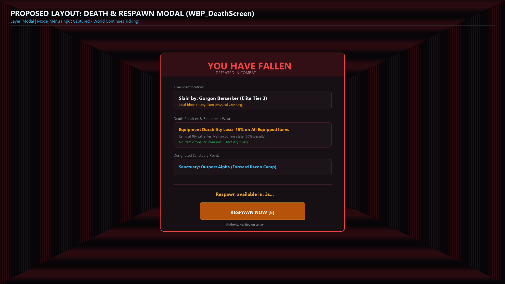
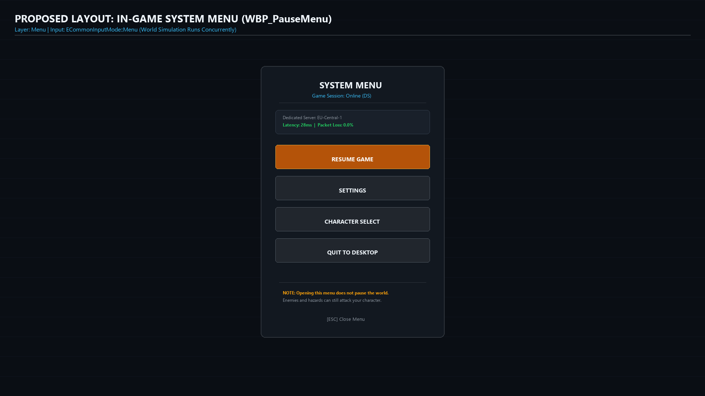
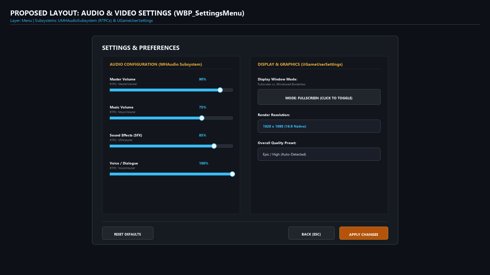
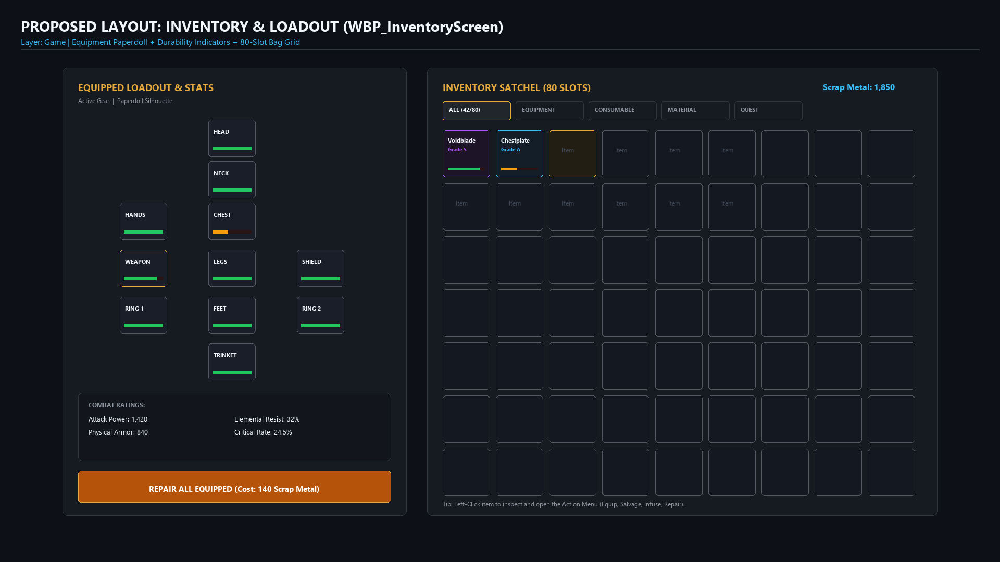
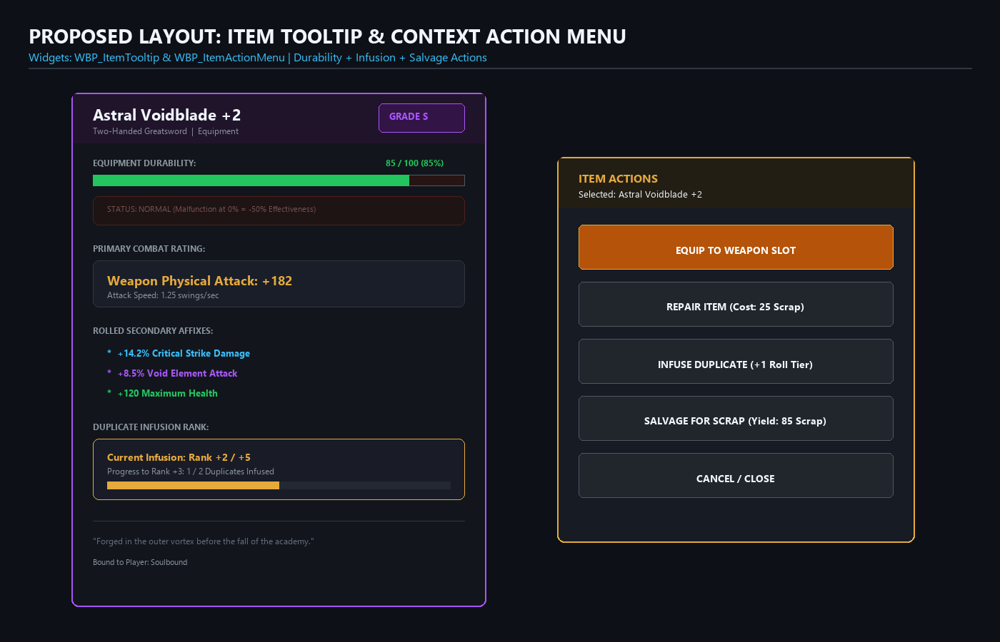

# 📘 UI Architecture & Implementation Guide
**File:** `/Docs/UI/UI_Implementation_Guide.md`  
**Target Engine:** Unreal Engine 5.8.3  
**Framework:** CommonUI + UMG + Gameplay Ability System (GAS) + MHAudio  

---

## 1. System Overview & Architecture

The Onset UI framework is built around **CommonUI** activatable screens managed by `UOnsetUISubsystem`, layered on top of an authoritatively synchronized combat HUD (`UHUDWidget`). All core gameplay logic, network RPC routing, audio RTPC modulation, and data model bindings are implemented in **C++**, leaving visual styling, animations, hierarchy layouts, and sound cues to **Widget Blueprints (`WBP_...`)**.

### Layer Model (`EOnsetUILayer`)
| Layer | Description | Routing Subsystem | Common Input Mode | Example Widgets |
| :--- | :--- | :--- | :--- | :--- |
| **Game** | In-game interactive overlays and toggled gameplay menus. | `PushScreen(Game)` | GameAndMenu / Game | `WBP_InventoryScreen` |
| **Menu** | System & escape menus capturing UI navigation without stopping the online simulation. | `PushScreen(Menu)` | Menu (UI Focus Only / Simulation Continues) | `WBP_PauseMenu`, `WBP_SettingsMenu` |
| **Modal** | Top-priority blocking dialogs and state gates. | `PushScreen(Modal)` | Menu (UI Only, Focus Trapped) | `WBP_DeathScreen`, Confirmation Modals |
| **Viewport / HUD** | Non-activatable persistent combat HUD and indicators. | `AOnsetPlayerController` Viewport | Game Only | `WBP_HUD` (Health, Buffs, Cast Bar, Paperdoll, Quest) |

---

## 2. Death & Respawn System

### C++ Class: `UOnsetDeathScreen`
- **Base Class:** `UOnsetScreenBase` (`UCommonActivatableWidget`)
- **Layer:** `EOnsetUILayer::Modal`
- **Header:** [`Project/Source/Onset/Public/UI/OnsetDeathScreen.h`](file:///e:/Unreal%20Projects/PortfolioTutorial/Project/Source/Onset/Public/UI/OnsetDeathScreen.h)
- **Source:** [`Project/Source/Onset/Private/UI/OnsetDeathScreen.cpp`](file:///e:/Unreal%20Projects/PortfolioTutorial/Project/Source/Onset/Private/UI/OnsetDeathScreen.cpp)

### Purpose & Flow
When the player pawn's health drops to 0, `AOnsetPlayerCharacter::OnDeath` triggers. Rather than instantly respawning or leaving the screen blank, it packages a death summary struct (`FOnsetDeathReport`) containing:
1. `KillerName` (Resolved from `AOnsetEnemy` stats row, killer player pawn name, or combat hazard).
2. `DurabilityLossPercent` (Standard 15% equipment wear on defeat).
3. `RespawnDelay` (Mandatory cooldown, default 5.0 seconds).
4. `RespawnLocationName` (Target recovery outpost / sanctuary).

The server transmits this via `Client_ShowDeathScreen(FOnsetDeathReport)` to `AOnsetPlayerController`. The client pushes `WBP_DeathScreen` onto the Modal layer. The player can either wait out the countdown timer or click **Respawn Now** once unlocked. The client then issues `Server_RequestRespawn()`, which re-seeds the character, restores health, updates durability, dismisses the death screen, and re-enables inputs.

### Widget Blueprint Contract (`WBP_DeathScreen`)
Derive from `UOnsetDeathScreen`.

| Widget Name | Type | Binding Type | Description |
| :--- | :--- | :--- | :--- |
| `KillerText` | `UCommonTextBlock` | `meta = (BindWidgetOptional)` | Formatted killer banner: *"Slain by [KillerName]"*. |
| `DurabilityLossText` | `UCommonTextBlock` | `meta = (BindWidgetOptional)` | Penalty readout: *"Equipment Durability Loss: -15%"*. |
| `RespawnLocationText`| `UCommonTextBlock` | `meta = (BindWidgetOptional)` | Location label: *"Respawn Point: [Location]"*. |
| `TimerText` | `UCommonTextBlock` | `meta = (BindWidgetOptional)` | Real-time countdown: *"Respawn available in 4s..."*. |
| `RespawnButton` | `UOnsetButtonBase` | `meta = (BindWidgetOptional)` | Action button disabled during countdown, enabled at 0s. |

### Visual Layout Specification

#### Canvas Hierarchy & Anchors
- **Root Canvas Panel** (Full Screen 1920x1080)
  - `Border_Vignette`: Anchors `[0, 0, 1, 1]`, Offsets `(0, 0, 0, 0)`, Brush tint: Dark Red/Black semi-transparent `RGBA(0.03, 0.02, 0.03, 0.88)`
  - `SizeBox_ModalContainer`: Anchors Center `[0.5, 0.5]`, Alignment `(0.5, 0.5)`, Width `700px`, Height `680px`
    - `Border_Card`: Rounded dark acrylic slate background with `ACCENT_RED` outline (2px)
      - `VerticalBox_Content`:
        - `Border_Banner`: Dark red banner header with `"YOU HAVE FALLEN"` (36pt bold)
        - `Spacer` (20px)
        - `VerticalBox_Killer`: `KillerText` (*"Slain by: Gorgon Berserker (Elite Tier 3)"*)
        - `Spacer` (15px)
        - `VerticalBox_Penalty`: `DurabilityLossText` (*"-15% Equipment Durability Loss"*)
        - `Spacer` (15px)
        - `VerticalBox_Sanctuary`: `RespawnLocationText` (*"Sanctuary: Outpost Alpha"*)
        - `Spacer` (25px)
        - `TimerText`: Real-time countdown (*"Respawn available in 3s..."*)
        - `Spacer` (15px)
        - `RespawnButton`: Large glowing button `[RESPAWN NOW]` (Enabled when timer reaches 0s)

---

## 3. System & In-Game Escape Menu ("Pause Menu")

> [!NOTE]
> **No Game Pause on Dedicated Server:**  
> In Onset's dedicated-server multiplayer architecture, the game simulation **never pauses**. Enemies, other players, combat ticks, and cooldowns continue updating. "Pause Menu" is used strictly as industry-standard player-facing terminology for the in-game Escape/System menu. Activating this screen sets the local input mode to `ECommonInputMode::Menu` (capturing mouse/keyboard focus for UI widgets and releasing camera control), but the live game world continues running uninterrupted around the player.

### C++ Class: `UOnsetPauseMenuScreen`
- **Base Class:** `UOnsetScreenBase`
- **Layer:** `EOnsetUILayer::Menu`
- **Header:** [`Project/Source/Onset/Public/UI/OnsetPauseMenuScreen.h`](file:///e:/Unreal%20Projects/PortfolioTutorial/Project/Source/Onset/Public/UI/OnsetPauseMenuScreen.h)
- **Source:** [`Project/Source/Onset/Private/UI/OnsetPauseMenuScreen.cpp`](file:///e:/Unreal%20Projects/PortfolioTutorial/Project/Source/Onset/Private/UI/OnsetPauseMenuScreen.cpp)

### Purpose & Flow
Toggled in-game via the Escape key (`AOnsetPlayerController::TogglePauseMenu`). Captures input, focuses UI navigation, and provides options to resume gameplay, open settings, return to character select, or quit to desktop.

### Widget Blueprint Contract (`WBP_PauseMenu`)
Derive from `UOnsetPauseMenuScreen`.

| Widget Name | Type | Binding Type | Description |
| :--- | :--- | :--- | :--- |
| `ResumeButton` | `UOnsetButtonBase` | `meta = (BindWidgetOptional)` | Pops `WBP_PauseMenu` and restores game input. |
| `SettingsButton` | `UOnsetButtonBase` | `meta = (BindWidgetOptional)` | Pushes `WBP_SettingsMenu` onto the Menu layer. |
| `CharacterSelectButton` | `UOnsetButtonBase` | `meta = (BindWidgetOptional)` | Cleans up session and returns to character selection. |
| `QuitDesktopButton` | `UOnsetButtonBase` | `meta = (BindWidgetOptional)` | Quits the game client (`UKismetSystemLibrary::QuitGame`). |

### Visual Layout Specification

#### Canvas Hierarchy & Anchors
- **Root Canvas Panel** (Full Screen 1920x1080)
  - `Border_Dimmer`: Fullscreen subtle backdrop tint `RGBA(0.04, 0.05, 0.08, 0.65)`
  - `SizeBox_Drawer`: Anchors Center `[0.5, 0.5]`, Alignment `(0.5, 0.5)`, Width `500px`, Height `740px`
    - `Border_DrawerPanel`: Dark slate panel with rounded corners and subtle blue border
      - `VerticalBox_DrawerContent`:
        - `TextBlock_Title`: `"SYSTEM MENU"` (24pt bold, white)
        - `TextBlock_Session`: `"Game Session: Online (DS)"` (14pt cyan)
        - `Separator` (1px)
        - `Border_ServerStatus`: Ping / Packet loss readout (Latency: 28ms, Server: EU-Central-1)
        - `Spacer` (25px)
        - `VerticalBox_Buttons`:
          - `ResumeButton`: `[RESUME GAME]` (Primary Gold)
          - `SettingsButton`: `[SETTINGS]`
          - `CharacterSelectButton`: `[CHARACTER SELECT]`
          - `QuitDesktopButton`: `[QUIT TO DESKTOP]`
        - `Spacer` (20px)
        - `Border_Notice`: Warning note that the world simulation continues ticking while open

---

## 4. Settings Screen (Audio & Video)

### C++ Class: `UOnsetSettingsScreen`
- **Base Class:** `UOnsetScreenBase`
- **Layer:** `EOnsetUILayer::Menu`
- **Header:** [`Project/Source/Onset/Public/UI/OnsetSettingsScreen.h`](file:///e:/Unreal%20Projects/PortfolioTutorial/Project/Source/Onset/Public/UI/OnsetSettingsScreen.h)
- **Source:** [`Project/Source/Onset/Private/UI/OnsetSettingsScreen.cpp`](file:///e:/Unreal%20Projects/PortfolioTutorial/Project/Source/Onset/Private/UI/OnsetSettingsScreen.cpp)

### Purpose & Audio RTPC Integration
Controls master, music, sfx, and voice volume sliders. Volume changes update in real time via the modular `UMHAudioSubsystem` using RTPC names:
- `MasterVolume` [0.0 - 1.0]
- `MusicVolume` [0.0 - 1.0]
- `SFXVolume` [0.0 - 1.0]
- `VoiceVolume` [0.0 - 1.0]

Display options (Windowed vs. Fullscreen) are wired directly to `UGameUserSettings` and applied with `ApplySettings(false)`.

### Widget Blueprint Contract (`WBP_SettingsMenu`)
Derive from `UOnsetSettingsScreen`.

| Widget Name | Type | Binding Type | Description |
| :--- | :--- | :--- | :--- |
| `MasterVolumeSlider` | `USlider` | `meta = (BindWidgetOptional)` | Real-time slider (0.0 to 1.0) bound to `MasterVolume`. |
| `MusicVolumeSlider` | `USlider` | `meta = (BindWidgetOptional)` | Real-time slider bound to `MusicVolume`. |
| `SFXVolumeSlider` | `USlider` | `meta = (BindWidgetOptional)` | Real-time slider bound to `SFXVolume`. |
| `VoiceVolumeSlider` | `USlider` | `meta = (BindWidgetOptional)` | Real-time slider bound to `VoiceVolume`. |
| `FullscreenToggleButton` | `UOnsetButtonBase` | `meta = (BindWidgetOptional)` | Toggles window mode state. |
| `FullscreenLabel` | `UCommonTextBlock` | `meta = (BindWidgetOptional)` | Displays *"Fullscreen"* or *"Windowed"*. |
| `ApplyButton` | `UOnsetButtonBase` | `meta = (BindWidgetOptional)` | Commits video settings to user configuration. |
| `ResetDefaultsButton` | `UOnsetButtonBase` | `meta = (BindWidgetOptional)` | Resets audio sliders to 100% and reapplies RTPCs. |
| `BackButton` | `UOnsetButtonBase` | `meta = (BindWidgetOptional)` | Pops settings screen, returning to pause menu. |

### Visual Layout Specification

#### Canvas Hierarchy & Anchors
- **Root Canvas Panel** (Full Screen 1920x1080)
  - `SizeBox_SettingsPanel`: Anchors Center `[0.5, 0.5]`, Alignment `(0.5, 0.5)`, Width `1200px`, Height `820px`
    - `Border_SettingsCard`: Rounded dark acrylic panel
      - `VerticalBox_Settings`:
        - `TextBlock_SettingsTitle`: `"SETTINGS & PREFERENCES"` (24pt bold)
        - `HorizontalBox_Columns`:
          - `VerticalBox_AudioCol` (Left Pane, Width `540px`):
            - `MasterVolumeSlider` (Track + Fill + Thumb, bound to RTPC `MasterVolume`)
            - `MusicVolumeSlider` (bound to RTPC `MusicVolume`)
            - `SFXVolumeSlider` (bound to RTPC `SFXVolume`)
            - `VoiceVolumeSlider` (bound to RTPC `VoiceVolume`)
          - `Spacer` (40px)
          - `VerticalBox_VideoCol` (Right Pane, Width `540px`):
            - `FullscreenToggleButton` + `FullscreenLabel` (*"Fullscreen"* vs *"Windowed"*)
            - Resolution readout & Graphics quality presets
        - `HorizontalBox_Footer`:
          - `ResetDefaultsButton` (Left-aligned)
          - `Spacer` (Fill)
          - `BackButton` (Right-aligned)
          - `ApplyButton` (Right-aligned Primary Gold)

---

## 5. Inventory, Durability & Item Interactions

### Overview of Components
- **`UInventoryScreen`** (`WBP_InventoryScreen`): Full-screen bag grid + equipped paperdoll slots + **Repair All** button.
- **`UInventorySlotWidget`** (`WBP_InventorySlot`): Cell displaying item icon, count, quality grade color ring, and durability status bar.
- **`UOnsetItemTooltipWidget`** (`WBP_ItemTooltip`): Rich tooltip showing item name, quality tier (Grade D to S), durability bar, malfunctioning penalty warning, combat ratings (attack/defense), and duplicate infusion level.
- **`UOnsetItemActionMenuWidget`** (`WBP_ItemActionMenu`): Contextual action popup menu appearing when an item is selected, offering **Equip / Unequip**, **Repair**, **Infuse Duplicate**, and **Salvage** actions.

### Tooltip Widget Blueprint Contract (`WBP_ItemTooltip`)
Derive from `UOnsetItemTooltipWidget`.

| Widget Name | Type | Binding Type | Description |
| :--- | :--- | :--- | :--- |
| `ItemNameText` | `UCommonTextBlock` | `meta = (BindWidgetOptional)` | Displays formatted item display name. |
| `CategoryText` | `UCommonTextBlock` | `meta = (BindWidgetOptional)` | Item category (Equipment, Consumable, Material). |
| `QualityGradeBadge` | `UCommonTextBlock` | `meta = (BindWidgetOptional)` | Grade label (*"GRADE D"*, *"GRADE S"*) colored by quality tier. |
| `DurabilityBar` | `UProgressBar` | `meta = (BindWidgetOptional)` | 0.0 to 1.0 progress bar tinted green/yellow/red. |
| `DurabilityText` | `UCommonTextBlock` | `meta = (BindWidgetOptional)` | Numeric text: *"100 / 100 (100%)"*. |
| `MalfunctioningBanner`| `UWidget` | `meta = (BindWidgetOptional)` | Red flashing banner visible only when Durability == 0. |
| `PrimaryStatText` | `UCommonTextBlock` | `meta = (BindWidgetOptional)` | *"Attack: 42"* or *"Defense: 28"*. |
| `SecondaryStatsText`| `UCommonTextBlock` | `meta = (BindWidgetOptional)` | Multi-line bonus stats (Crit Rate, Bonus HP, etc.). |
| `InfusionText` | `UCommonTextBlock` | `meta = (BindWidgetOptional)` | Infusion rank: *"Infusion Level: +3"*. |
| `InfusionProgressBar`| `UProgressBar` | `meta = (BindWidgetOptional)` | Progress bar to next infusion rank. |

### Contextual Action Menu Contract (`WBP_ItemActionMenu`)
Derive from `UOnsetItemActionMenuWidget`.

| Widget Name | Type | Binding Type | Description |
| :--- | :--- | :--- | :--- |
| `ItemTitleText` | `UCommonTextBlock` | `meta = (BindWidgetOptional)` | Header text with selected item's name. |
| `EquipUnequipButton`| `UOnsetButtonBase` | `meta = (BindWidgetOptional)` | Shows *"Equip"* for bag items or *"Unequip"* for equipped gear. |
| `RepairButton` | `UOnsetButtonBase` | `meta = (BindWidgetOptional)` | Calls `Server_RepairItem(SlotIndex)` using scrap metal. |
| `InfuseButton` | `UOnsetButtonBase` | `meta = (BindWidgetOptional)` | Calls duplicate infusion mechanism to boost stat roll tier. |
| `SalvageButton` | `UOnsetButtonBase` | `meta = (BindWidgetOptional)` | Calls `Server_SalvageItem(SlotIndex)` to break down into scrap. |
| `CloseButton` | `UOnsetButtonBase` | `meta = (BindWidgetOptional)` | Closes the popup action menu. |

### Visual Layout Specification: Full Inventory Screen

#### Canvas Hierarchy & Anchors
- **Root Canvas Panel** (Full Screen 1920x1080)
  - `HorizontalBox_Panes`: Anchors Center `[0.5, 0.5]`, Alignment `(0.5, 0.5)`, Width `1680px`, Height `860px`
    - `Border_EquipmentPane` (Left, Width `660px`):
      - `Title`: `"EQUIPPED LOADOUT & STATS"`
      - `Canvas_Paperdoll`: Freeform slot widgets arranged around character silhouette:
        - `HeadSlot` `(X:250, Y:80)`, `NeckSlot` `(X:250, Y:160)`, `ChestSlot` `(X:250, Y:240)`
        - `HandsSlot` `(X:80, Y:240)`, `WeaponSlot` `(X:80, Y:330)`, `Ring1Slot` `(X:80, Y:420)`
        - `ShieldSlot` `(X:420, Y:330)`, `Ring2Slot` `(X:420, Y:420)`, `LegsSlot` `(X:250, Y:330)`
        - `FeetSlot` `(X:250, Y:420)`, `TrinketSlot` `(X:250, Y:510)`
      - `Border_StatsPreview`: Primary stats breakdown (Attack Power, Armor, Elemental Resistance, Crit)
      - `RepairAllButton`: Full-width button `[REPAIR ALL EQUIPPED (Cost: 140 Scrap)]`
    - `Spacer` (40px)
    - `Border_BagPane` (Right, Width `980px`):
      - `Header`: Title + Currency/Scrap Counter (`Scrap: 1,850`)
      - `HorizontalBox_FilterTabs`: `[ALL]`, `[EQUIPMENT]`, `[CONSUMABLE]`, `[MATERIAL]`, `[QUEST]`
      - `ScrollBox_Bag`:
        - `BagGrid`: `UniformGridPanel` (8 columns x 10 rows = 80 cells of `WBP_InventorySlot`)

---

### Visual Layout Specification: Item Inspection Tooltip & Context Action Menu

#### Tooltip (`WBP_ItemTooltip`) Hierarchy
- `Border_TooltipCard` (Width `580px`, Dark slate with Quality Tier colored border)
  - `VerticalBox_Content`:
    - `Header`: `ItemNameText` (*"Astral Voidblade +2"*), `CategoryText` (*"Two-Handed Greatsword"*), `QualityGradeBadge` (*"GRADE S"* with Purple tint)
    - `DurabilitySection`: `DurabilityText` (*"85 / 100 (85%)"*), `DurabilityBar` (Progress bar tinted green/yellow/red)
    - `MalfunctioningBanner`: Flashing red caution banner visible only if Durability == 0
    - `PrimaryStatSection`: `PrimaryStatText` (*"Weapon Physical Attack: +182"*)
    - `SecondaryStatsSection`: `SecondaryStatsText` (Dynamic bulleted affixes: Crit Damage, Elemental Attack, Bonus HP)
    - `InfusionSection`: `InfusionText` (*"Infusion Rank +2 / +5"*), `InfusionProgressBar`
    - `LoreSection`: Italic item lore text & binding rule (*"Soulbound"*)

#### Action Menu (`WBP_ItemActionMenu`) Hierarchy
- `Border_ActionMenuCard` (Width `400px`, Floating popup anchored to clicked slot or mouse cursor)
  - `VerticalBox_Actions`:
    - `ItemTitleText`: Header banner with selected item title
    - `EquipUnequipButton`: `[EQUIP TO SLOT]` or `[UNEQUIP]`
    - `RepairButton`: `[REPAIR ITEM (Cost: 25 Scrap)]`
    - `InfuseButton`: `[INFUSE DUPLICATE (+1 Roll Tier)]`
    - `SalvageButton`: `[SALVAGE FOR SCRAP (Yield: 85 Scrap)]`
    - `CloseButton`: `[CANCEL / CLOSE]`

---

## 6. Tactical HUD Additions

All tactical widgets are owned and driven by `UHUDWidget` (`WBP_HUD`), initialized during player pawn possession (`BindToPlayer`).

### 1. Buff & Status Effect Bar (`WBP_BuffBar`)
- **C++ Class:** `UOnsetBuffBarWidget` & `UOnsetBuffIconWidget`
- **Bound ASC Tags:**
  - `TAG_State_Stunned` (Debuff - Amber/Red)
  - `TAG_State_Frozen` (Debuff - Blue/Cyan)
  - `TAG_State_Staggered` (Debuff - Orange)
  - `TAG_State_Invulnerable` (Buff - Gold)
  - `Debuff.Burn`, `Debuff.Slow`, `Buff.Haste`
- **Widget Setup:** Place `UHorizontalBox` named `BuffContainer`. Specify `BuffIconWidgetClass = WBP_BuffIcon`.

### 2. Ability Cast & Channel Bar (`WBP_CastBar`)
- **C++ Class:** `UOnsetCastBarWidget`
- **Events:**
  - `StartCast(AbilityName, Duration, bIsChannel)`: Starts timer, fills (or depletes if channel) `CastProgressBar`, displays `AbilityNameText`.
  - `InterruptCast()`: Turns bar red, displays *"INTERRUPTED"*, flashes briefly, and dismisses.
  - `FinishCast()`: Fills completely and fades out.
- **Widget Setup:** Place `UProgressBar` named `CastProgressBar` and `UCommonTextBlock` named `AbilityNameText`.

### 3. Equipment Durability Warning Paperdoll (`WBP_DurabilityWarning`)
- **C++ Class:** `UOnsetDurabilityWarningWidget`
- **Behavior:** Subscribes to `UOnsetInventoryComponent::OnInventoryChanged`. When any equipped item falls below 20% durability, displays an amber caution paperdoll icon. When any item reaches 0% (Malfunctioning, incurring a 50% stat penalty), displays a blinking red warning icon.
- **Widget Setup:** Place `UImage` named `WarningIcon` and `UCommonTextBlock` named `WarningText`.

### 4. Quest & Objective Tracker (`WBP_QuestTracker`)
- **C++ Class:** `UOnsetQuestTrackerWidget`
- **Behavior:** Subscribes to `UOnsetQuestComponent::OnQuestsChanged`. Iterates active quests and stages from `DT_Quests`, creating dynamic objective text blocks with green color-coding for completed objectives and gold headers for quest names.
- **Widget Setup:** Place `UVerticalBox` named `QuestListContainer`.

---

## 7. Blueprint Authoring & Hierarchy Checklist

To set up the new UI widgets in the Unreal Editor:

1. **`Content/UI/Death/WBP_DeathScreen`**
   - Reparent to `OnsetDeathScreen`.
   - Add Root `Border` (Dark semi-transparent red vignette).
   - Add `UVerticalBox`:
     - Text: `KillerText`
     - Text: `DurabilityLossText`
     - Text: `RespawnLocationText`
     - Text: `TimerText`
     - Button (`WBP_ButtonBase`): `RespawnButton`
   - In Project Settings / Game Mode, assign `WBP_DeathScreen` as the death screen widget.

2. **`Content/UI/Menu/WBP_PauseMenu`**
   - Reparent to `OnsetPauseMenuScreen`.
   - Add `UOnsetButtonBase` children:
     - `ResumeButton`
     - `SettingsButton`
     - `CharacterSelectButton`
     - `QuitDesktopButton`

3. **`Content/UI/Menu/WBP_SettingsMenu`**
   - Reparent to `OnsetSettingsScreen`.
   - Add Sliders: `MasterVolumeSlider`, `MusicVolumeSlider`, `SFXVolumeSlider`, `VoiceVolumeSlider`.
   - Add Buttons: `FullscreenToggleButton`, `ApplyButton`, `ResetDefaultsButton`, `BackButton`.
   - Add Text: `FullscreenLabel`.

4. **`Content/UI/Inventory/WBP_ItemTooltip` & `WBP_ItemActionMenu`**
   - Reparent `WBP_ItemTooltip` to `OnsetItemTooltipWidget`.
   - Reparent `WBP_ItemActionMenu` to `OnsetItemActionMenuWidget`.
   - In `WBP_InventoryScreen`, bind `ActionMenu` (`WBP_ItemActionMenu`) and `ItemTooltip` (`WBP_ItemTooltip`).
   - Add `RepairAllButton` (`WBP_ButtonBase`) to `WBP_InventoryScreen`.

5. **`Content/UI/HUD/WBP_HUD`**
   - Add `WBP_BuffBar` named `BuffBar`.
   - Add `WBP_CastBar` named `CastBar`.
   - Add `WBP_DurabilityWarning` named `DurabilityWarning`.
   - Add `WBP_QuestTracker` named `QuestTracker`.

---

## 8. Multiplayer & Server Authority Summary

1. **Authoritative Respawn:** Death report generation, durability degradation, and respawn location assignment occur on the server. The client cannot force respawn before `RespawnDelay` has expired; `Server_RequestRespawn()` verifies server-side timestamps before restoring the pawn.
2. **Authoritative Inventory Actions:** Salvage, Repair, Infuse, Equip, and Unequip are strictly server RPCs (`Server_SalvageItem`, `Server_RepairItem`, `Server_InfuseItem`). The UI operates reactively on `OnInventoryChanged` replication.
3. **Audio Settings:** Audio sliders are purely client-side RTPC settings through `UMHAudioSubsystem` and do not produce unnecessary network traffic.
