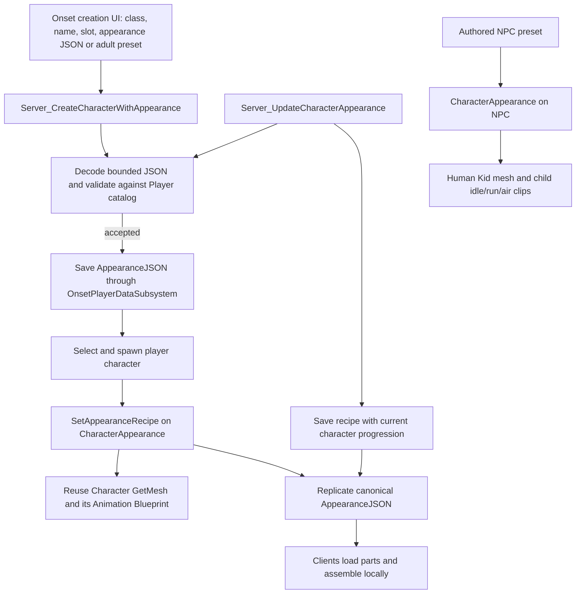

# Onset native appearance integration

Onset now owns player character creation, appearance validation, persistence and replication. Character Creator remains the art and clothing staging project. The `OnsetAppearance` runtime module supplies the versioned recipe, catalog validation and modular mesh assembly; Onset's `UOnsetCharacterAppearanceComponent` binds that assembly to the existing `ACharacter::GetMesh()` and replicates the accepted JSON recipe. No separate character-creation framework module is needed for this version.

## Supported characters and assets

| Use | Body ID | Preset | Notes |
| --- | --- | --- | --- |
| Player | `epic.adult.female` | `DA_EpicFemale` | Default and new menu index 0 |
| Player | `epic.adult.male` | `DA_EpicMale` | New menu index 1 |
| Authored NPC | `human.kid.authored` | `DA_HumanKidFemaleNPC` | Shared Human Kid body, female head |
| Authored NPC | `human.kid.authored` | `DA_HumanKidMaleNPC` | Shared Human Kid body, male head |

The catalog is `/Game/OnsetCharacterCreation/Catalog/DA_OnsetAppearanceCatalog`. Its current staging snapshot has three bodies, seven heads and 30 parts. The imported asset paths remain under `/Game/IS_CharacterCreator`. Only the two EpicHuman adult bodies validate for `Player` use; child recipes validate for `AuthoredCharacter` use. The legacy OldHuman baby body is not a character option. Some shared baby-mouth assets are dependencies of the selected set, so folder-name deletion is unsafe.

## Runtime flow

The existing `AOnsetPlayerCharacter` mesh component stays in place, including its transform and the `ABP_Unarmed` animation path. Replacing it with a leader-pose mannequin overlay would distort the EpicHuman body because its local bind transforms differ from the original mannequin. The new component assembles the modular body, head and clothing on the actual character mesh. Adult NPCs without an animation class receive `ABP_Unarmed`; Human Kid NPCs use their own skeleton and simple idle, run and air clips.

The component stores a canonical JSON recipe, replicates it to clients, and rebuilds parts locally. Server-side changes require authority. Creation and customization validate the request against the player-only catalog; child recipes are rejected for player pawns. In an editor map, serialized recipes rebuild synchronously on actor registration so authored actors are immediately inspectable. Runtime client reconstruction remains asynchronous.

## Creation, customization and compatibility

The existing integer creation API now maps 0 to EpicHuman female and 1 to EpicHuman male. `UCharacterCreationScreen::CreateCharacterWithAppearance` and `UCharacterSelectScreen::CreateCharacterWithAppearance` accept a full recipe JSON for later customizer controls. The controller exposes `Server_CreateCharacterWithAppearance` and `Server_UpdateCharacterAppearance`; completion or structured validation errors arrive through `Client_CharacterAppearanceResult` and the Blueprint event `BP_OnCharacterAppearanceResult`.

The creation screen now fills the existing Onset three-panel `WBP_CharacterCreation` layout at activation. The right panel keeps Onset's class choices; the center keeps the callsign field and hosts a modular character preview; the left panel provides scrollable, catalog-driven adult body, head, clothing, morph, skin, eye and outfit-colour options. The old nine-preset grid is hidden. A native confirmation button uses the existing footer style and sends the validated draft recipe through `Server_CreateCharacterWithAppearance`. It replaces the old Blueprint click path, which required a selected preset button and deactivated the screen before a server result. Server errors are shown in the screen and the button is re-enabled. The screen remains open while creation is pending.

On possession, `AppearanceJSON` is loaded from the existing character record and applied to the pawn. Old stored records containing an integer `PresetIndex` resolve to the EpicHuman female preset because the old `BP_ApplyAppearancePreset` event left the default female mannequin unchanged for the tested values 0, 1, 2, 3 and 255. The old record is not rewritten just by loading it. Empty appearance data also uses the female default. Malformed or unsupported saved data is retained for diagnosis; it does not get silently replaced in storage.

Customization checks the authenticated account, selected slot and pawn persistence identity on the server. It preserves the pawn's current level, experience and unspent points when saving the recipe. If persistence fails, it restores the previous recipe and runtime progression cache. A successful save refreshes the data subsystem's identity cache so later autosaves retain the edit. Character class, starter items, naming and account records remain Onset-owned.

## Editor review and verification

Open `/Game/OnsetCharacterCreation/Maps/NativeOnsetAppearancePreview` in **Onset**. It contains the actual player Blueprint with EpicHuman female and male presets and two `AOnsetBaseCharacter` Human Kid NPC variants. Each actor stores its recipe on `CharacterAppearance`; child actors also have `AuthoredPreset`. This map is for editor review, not the gameplay default map.

`Scripts/CreateOnsetAppearanceReview.py` creates the map once and refuses to overwrite it. `Scripts/VerifyOnsetAppearanceReview.py` reloads the map in a fresh editor process and checks that each actor has a serialized recipe, assembled body, head, and every selected clothing mesh. The map was created and this reload check passed for all four actors: five clothing meshes on each adult and three on each child. The `OnsetAppearanceIntegrationAudit` commandlet passed with zero failures after the final compile. It checks catalog/presets, player-only restrictions, assembly, reused player mesh and animation class, morph retention, child rig selection, bounded JSON identifiers, an OnRep reconstruction path, and an isolated SQLite save/edit/reload fixture. Module-filtered `OnsetEditor`, `OnsetClient` and `OnsetServer` Win64 Development C++ builds succeeded with `-NoPCH`. These client/server checks compile project modules but do not link packaged executables.

The migrated dependency inventory is `Docs/AppearanceMigrationDependencies.json`: 53 direct roots led to 182 game packages; 181 available packages were copied. The missing `/Game/IS_CharacterCreator/Character/EpicHuman/Maturity/Adult/Meshes/Mannequin` was a skeleton preview-mesh reference. Onset's adult and Human Kid skeleton preview metadata now points to imported meshes. Adult and child animation clips were copied beyond the inventory closure. Four small step-notify/audio packages were added for the clips; two legacy animation Blueprints were removed because they required the old creator framework. Onset always cooks `/Game/OnsetCharacterCreation` and `/Game/IS_CharacterCreator`. A targeted Windows cook of the review map completed successfully: 896 packages, no missing package references. It still emits a warning about the source OldHuman adult-head Rig class.

## Remaining work before release

1. Inspect the review map visually in the Onset editor, then exercise player movement, combat montages and child NPC motion in a running level. The Human Kid implementation currently has basic idle/run/air switching, not a complete blended combat graph.
2. Open character creation in the Onset editor and review the new controls at the target menu resolutions. Verify the UMG viewport camera framing, scrolling, button styles, focus/gamepad navigation and error presentation. The headless commandlet confirmed that the existing Widget Blueprint loads and that the Blueprint class/field bindings match; it could not render the live menu. The in-game customization screen still needs its own UI, using the same recipe controls and `Server_UpdateCharacterAppearance`.
3. Test two authenticated clients, late join, zone travel, respawn, customization saves and failed saves against a test account. The commandlet simulates OnRep but is not a network-session test.
4. Package client and server and run the cooked builds. The targeted editor cook passed, but a full packaged runtime session remains to be checked. Remove further legacy creator assets only after a dependency audit and accepted playtest.

Clothing production instructions for a separate art agent are in `E:/Unreal Projects/Character Creator/Docs/BlenderClothingHandover.md`. New outfits should be imported and validated in Character Creator, then catalog and required packages migrated into Onset without overwriting unrelated project assets.
